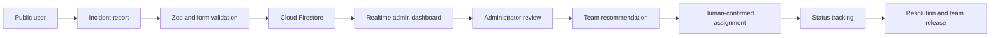

# DIASA

[](https://react.dev/)
[](https://www.typescriptlang.org/)
[](https://vite.dev/)
[](https://firebase.google.com/)
[](https://vitest.dev/)

**Centralized emergency reporting. Clearer incident management.**

DIASA is an Emergency Response & Disaster Management Platform for public incident reporting and authorized administrator operations. It provides a shared workflow for submitting incidents, classifying preliminary severity, monitoring live records, managing response teams, and confirming team assignments.

> DIASA is a software prototype. It does not independently dispatch emergency services, replace official emergency channels, or guarantee a response. Human review is required.

Repository: [github.com/Karthikdj2028/disha](https://github.com/Karthikdj2028/disha)

## Table Of Contents

- [Problem Statement](#problem-statement)
- [Current Features](#current-features)
- [Severity Classification](#severity-classification)
- [Technology Stack](#technology-stack)
- [Project Structure](#project-structure)
- [Installation And Setup](#installation-and-setup)
- [How It Works](#how-it-works)
- [Modules](#modules)
- [Team Matching Algorithm](#team-matching-algorithm)
- [Scalability](#scalability)
- [Feasibility](#feasibility)
- [Novelty And Comparative Analysis](#novelty-and-comparative-analysis)
- [Feature Depth And Edge Cases](#feature-depth-and-edge-cases)
- [Database Schema](#database-schema)
- [Security And Privacy](#security-and-privacy)
- [Future Roadmap](#future-roadmap)
- [Ethical Use And Operational Disclaimer](#ethical-use-and-operational-disclaimer)
- [Testing And Build Verification](#testing-and-build-verification)
- [License](#license)
- [Author And Repository](#author-and-repository)

## Problem Statement

Emergency reports are often fragmented across phone calls, informal messages, spreadsheets, and disconnected department workflows. This makes it difficult to establish a consistent incident record, compare urgency, identify available response capacity, and retain an auditable history of operational decisions.

DIASA addresses this problem with a centralized browser application that:

- Accepts public incident reports without requiring a reporter account.
- Stores validated reports in Cloud Firestore.
- Applies a deterministic, explainable preliminary severity classification.
- Gives authorized administrators a realtime incident view.
- Maintains response-team capabilities, availability, and manually entered locations.
- Provides transparent team recommendations and human-confirmed assignment transactions.
- Preserves assignment history as teams are reassigned or released.

DIASA is not an emergency-services replacement and is not presented as a certified or government-approved system.

## Current Features

### Implemented

- Public emergency reporting at `/report` without public authentication.
- Exactly six incident categories:
  - Fire Emergency
  - Road Accident
  - Medical Emergency
  - Flood
  - Building Collapse
  - Other Emergencies
- Required incident title, description, category, manual location, and people affected fields.
- Optional contact information and optional manually entered coordinates.
- Zod and React Hook Form validation.
- Firestore persistence with realtime listeners.
- Preliminary severity classification with stored score and explanation.
- Firebase email/password administrator authentication.
- UID-based administrator authorization using `admins/{uid}` with `role: "admin"` and `active: true`.
- Protected administrator routes and session restoration.
- Password-reset email flow at `/admin/forgot-password`.
- Realtime incident dashboard with actual Firestore data.
- Incident search, severity/status filters, detail views, status updates, and deletion confirmation.
- Response-team creation, listing, availability updates, manually entered coordinates, and deletion safeguards.
- Haversine straight-line distance calculation.
- Capability and availability filtering for team recommendations.
- Recommendation scoring using capability, distance, capacity, and location freshness.
- Human-confirmed assignment, reassignment, and release transactions.
- Active assignment display and assignment history.
- Firestore security rules for public report creation and administrator operations.
- English, Tamil, and Hindi language resources with persistent language selection.
- Translated public reporting, authentication, dashboard, incident, team, assignment, and detail interfaces.
- Intl-based date and number formatting in migrated operational views.

### Not Currently Implemented

The following are planned or proposed, not current product capabilities:

- Interactive map visualization and road-routing/ETA integration.
- Analytics-specific route and advanced chart suite.
- Multi-organization tenant isolation and full public-sector RBAC hierarchy.
- Personnel, duty scheduling, training, inventory, shelters, aid distribution, or volunteer modules.
- Duplicate incident detection, confidence scoring, command timelines, or simulation mode.
- SMS, email, push, WhatsApp, or official alert-provider integrations.
- Autonomous dispatch or automatic incident merging.
- Native mobile applications.

## Severity Classification

Every report receives a deterministic preliminary severity score from the category, people affected, and report text. The implementation is centralized in `src/lib/severityEngine.ts`.

### Category Weights

| Category | Weight |
| --- | ---: |
| Building Collapse | 4 |
| Fire Emergency | 3 |
| Road Accident | 2 |
| Medical Emergency | 2 |
| Flood | 2 |
| Other Emergencies | 1 |

### People Affected

| People affected | Additional score |
| --- | ---: |
| 0–1 | +0 |
| 2–4 | +1 |
| 5–9 | +2 |
| 10 or more | +3 |

### Text Signals

Critical keywords are `trapped`, `unconscious`, `explosion`, and `multiple casualties`. If any critical keyword is present, the implementation adds `+2`.

Urgent keywords are `injured`, `smoke`, `rising water`, and `burning`. If no critical keyword is present but an urgent keyword is found, the implementation adds `+1`.

### Thresholds

| Total score | Severity |
| ---: | --- |
| 0–1 | Low |
| 2–3 | Medium |
| 4–5 | High |
| 6 or more | Critical |

This is a preliminary software priority indicator. It is not medically or officially validated emergency triage and must not substitute for professional emergency assessment.

## Technology Stack

| Area | Technology |
| --- | --- |
| Frontend | React 19, TypeScript, Vite |
| Styling | Tailwind CSS v4 and project CSS |
| Routing | React Router |
| UI icons | Lucide React |
| Authentication | Firebase Authentication, email/password |
| Database | Cloud Firestore with `onSnapshot` realtime listeners |
| Validation | Zod and React Hook Form |
| Charts dependency | Recharts is installed for future/available charting work |
| Internationalization | i18next, react-i18next, i18next-browser-languagedetector |
| Testing | Vitest |
| Development | npm, Vite development server, TypeScript build, ESLint |

No privileged Firebase service-account credentials are used by the frontend.

## Project Structure

This tree excludes generated `node_modules/` and `dist/` directories and local secret configuration.

```text
D:\diasa
├── .env.example
├── .gitignore
├── eslint.config.js
├── firestore.rules
├── index.html
├── package.json
├── package-lock.json
├── project-docs
│   ├── 01-PRD.md
│   ├── 02-TRD.md
│   ├── 03-APP-FLOW.md
│   ├── 04-UI-UX-BRIEF.md
│   ├── 05-DATABASE-SCHEMA.md
│   ├── 06-IMPLEMENTATION-PLAN.md
│   ├── 07-MULTIAGENCY-EXPANSION.md
│   ├── 08-I18N-AND-ACCESSIBILITY.md
│   ├── 09-GOVERNMENT-READINESS.md
│   ├── GOVERNMENT-DEPLOYMENT-READINESS.md
│   └── IMPLEMENTATION-AUDIT.md
├── public
│   ├── favicon.svg
│   └── icons.svg
├── src
│   ├── App.tsx
│   ├── App.css
│   ├── index.css
│   ├── main.tsx
│   ├── assets
│   ├── components
│   │   ├── LanguageSelector.tsx
│   │   ├── ProtectedRoute.tsx
│   │   └── layout
│   │       └── AdminLayout.tsx
│   ├── contexts
│   │   ├── AuthContext.tsx
│   │   ├── contextValue.ts
│   │   └── useAuth.ts
│   ├── lib
│   │   ├── assignmentViewModel.ts
│   │   ├── assignmentViewModel.test.ts
│   │   ├── distanceCalculator.ts
│   │   ├── distanceCalculator.test.ts
│   │   ├── firebase.ts
│   │   ├── formatters.ts
│   │   ├── i18n.ts
│   │   ├── i18n.test.ts
│   │   ├── priorityEngine.ts
│   │   ├── priorityEngine.test.ts
│   │   ├── severityEngine.ts
│   │   ├── teamMatchingEngine.ts
│   │   ├── teamMatchingEngine.test.ts
│   │   ├── translatedLabels.ts
│   │   └── validation.ts
│   ├── locales
│   │   ├── en/common.json
│   │   ├── hi/common.json
│   │   ├── operations.ts
│   │   └── ta/common.json
│   ├── pages
│   │   ├── AdminLogin.tsx
│   │   ├── AssignmentsPage.tsx
│   │   ├── DashboardPage.tsx
│   │   ├── ForgotPassword.tsx
│   │   ├── IncidentDetailPage.tsx
│   │   ├── IncidentsPage.tsx
│   │   ├── ReportPage.tsx
│   │   └── TeamsPage.tsx
│   ├── services
│   │   ├── assignmentService.ts
│   │   ├── authService.ts
│   │   ├── incidentService.ts
│   │   └── teamService.ts
│   └── types
│       ├── assignment.ts
│       ├── incident.ts
│       └── responseTeam.ts
├── tsconfig.app.json
├── tsconfig.json
├── tsconfig.node.json
└── vite.config.ts
```

## Installation And Setup

### Prerequisites

- Node.js and npm compatible with the installed project toolchain.
- A Firebase project with Authentication and Cloud Firestore enabled.
- An authorized administrator account and matching Firestore document at `admins/{uid}`.
- Git, if cloning the repository.

### Clone And Install

```bash
git clone https://github.com/Karthikdj2028/disha.git
cd disha
npm install
```

The local workspace used for this implementation is `D:\diasa`. Adjust the directory name if your clone uses a different path.

### Configure Firebase

1. Copy `.env.example` to `.env.local`.
2. Add the Firebase web application configuration values to `.env.local`.
3. Do not commit `.env.local` or expose its values in documentation.
4. Ensure the Firebase project has:
   - Email/password Authentication enabled.
   - Cloud Firestore enabled.
   - An administrator Authentication account.
   - `admins/{authenticatedUserUID}` with `role: "admin"` and `active: true`.
5. Publish `firestore.rules` manually through the Firebase Console or an approved Firebase CLI workflow. Local rule changes do not deploy automatically.

Expected environment variable names are documented without values in `.env.example`:

```text
VITE_FIREBASE_API_KEY
VITE_FIREBASE_AUTH_DOMAIN
VITE_FIREBASE_PROJECT_ID
VITE_FIREBASE_STORAGE_BUCKET
VITE_FIREBASE_MESSAGING_SENDER_ID
VITE_FIREBASE_APP_ID
```

### Run Locally

```bash
npm run dev
```

The Vite development server will print the local URL. The application routes include:

- `/report`
- `/admin/login`
- `/admin/forgot-password`
- `/admin/dashboard`
- `/admin/incidents`
- `/admin/incidents/:id`
- `/admin/teams`
- `/admin/assignments`

### Build, Test, And Lint

```bash
npm run build
npm test
npm run lint
npm run preview
```

`npm run preview` serves the already-built `dist` output for local inspection.

## How It Works



Public reporters can create validated incidents but cannot read or manage incident records. Authorized administrators receive realtime records, review recommendations, confirm assignments, and track the lifecycle.

## Detailed Modules

### Public Reporting

`ReportPage` provides the six required categories, title, description, manual location, people affected, optional contact information, and optional latitude/longitude. Coordinates are not required for ordinary reporting. Successful submission displays the Firestore document reference.

The public form supports English, Tamil, and Hindi language switching without reloading. Form state is held in React Hook Form while the language selector changes the displayed labels.

### Administrator Authentication

`authService.ts` uses Firebase email/password authentication. After sign-in, the authenticated UID is checked against `admins/{uid}`. The account must have `role: "admin"` and `active: true`. Protected routes use the authentication context and redirect unauthorized users to `/admin/login`.

Password recovery uses Firebase `sendPasswordResetEmail`. There is no public administrator registration flow.

### Incident Management

Administrators can view realtime incidents, search by identifying fields, filter by severity and status, open details, update allowed statuses, and delete records after confirmation. Resolution of an actively assigned incident uses the transactional release workflow rather than a separate status-only update.

Canonical Firestore values remain in English. Translations affect only display labels.

### Severity Classification

`severityEngine.ts` computes and stores `severity`, `severityScore`, and `severityReason`. See [Severity Classification](#severity-classification) for the exact algorithm.

### Response Teams

`TeamsPage` and `teamService.ts` support administrator-controlled response-team records with team code, name, capabilities, availability, optional member count, and optional `GeoPoint` location. Duplicate team codes are rejected by the service before creation. A team with an active incident cannot be deleted by the Firestore rules.

### Team Matching

`teamMatchingEngine.ts` filters out unavailable teams, teams without valid coordinates, and teams without a capability matching the incident category. Eligible teams are ranked with a transparent score and explanation.

### Assignment Workflow

`AssignmentsPage` displays unassigned incidents, priority ranking, candidate teams, active assignments, and assignment history. The administrator must explicitly review and confirm a recommendation.

`assignmentService.ts` uses Firestore transactions to:

- Verify the incident and team still exist.
- Verify the team remains available.
- Verify the incident has no active assignment.
- Verify capability and coordinate eligibility.
- Mark the team `Busy` and attach the incident.
- Mark the incident `Assigned`.
- Create an assignment record and assignment event.
- Release the previous team during reassignment.
- Complete the assignment and return the team to `Available` on resolution.

No autonomous real-world dispatch occurs.

### Multilingual Support

The project uses i18next with English (`en`), Tamil (`ta`), and Hindi (`hi`) resources. Language selection persists in local storage and updates the document `lang` attribute. `Intl.DateTimeFormat` and `Intl.NumberFormat` are used in migrated operational views.

Translation completeness tests compare the English and Tamil/Hindi resource key structures. Some backend-generated explanations and service-originated Firebase errors remain English and are documented in [project-docs/08-I18N-AND-ACCESSIBILITY.md](project-docs/08-I18N-AND-ACCESSIBILITY.md).

## Team Matching Algorithm

Team recommendations require an incident coordinate and a valid team coordinate. The matching engine applies these mandatory filters:

1. Team availability must be `Available`.
2. The team must have a capability matching the incident category.
3. The incident and team must have valid coordinates.

The configurable recommendation weights are:

| Factor | Weight |
| --- | ---: |
| Capability suitability | 40% |
| Travel proximity | 35% |
| Capacity suitability | 15% |
| Location freshness | 10% |

Travel proximity is based on the Haversine formula from `distanceCalculator.ts`. It calculates straight-line distance over the earth's surface and is not road distance, route duration, or an emergency ETA. The current implementation does not invent road-routing results.

The recommendation includes the score, straight-line distance, capability result, availability, capacity contribution, location freshness contribution, and an explanation.

## Scalability

The current architecture can grow incrementally because Firebase access is isolated in services, domain contracts are typed, pure scoring logic is separated from UI, and security rules define collection boundaries. Realistic future work includes:

- Organization, department, and membership documents for tenant-scoped access.
- Trusted backend classification and audit processing.
- Cloud Functions or another trusted backend for rate limiting, abuse controls, and provider adapters.
- Pagination and query/index design for larger incident volumes.
- Dedicated analytics materialization for high-volume reporting.
- Replaceable routing adapters for actual road distance and travel duration.

These are architectural opportunities, not current guarantees of production scale.

## Feasibility

### Technical

The existing React/Vite/Firebase stack supports a browser-based pilot with realtime Firestore data, Firebase Authentication, typed service boundaries, and incremental modules. The current pure engines are inexpensive to execute in the browser. Larger deployments would need careful Firestore indexing, pagination, backend trust boundaries, and observability.

### Operational

DIASA can support a controlled workflow when administrators review reports, teams, and assignments. Operational procedures, staffing, escalation policies, data retention, and emergency-channel integration must be defined by the adopting organization.

### Financial

The current implementation uses Firebase web services and no paid routing provider. Actual operating cost depends on authentication, Firestore reads/writes, traffic, retention, support, monitoring, and any future map or notification provider. A production cost model has not been established here.

## Novelty And Comparative Analysis

Conventional fragmented workflows often separate public reporting, spreadsheets, team availability, and assignment notes. DIASA combines those current pilot functions into one browser workflow with deterministic scoring, realtime updates, transaction-based assignment, and preserved assignment history.

This is a scope comparison, not a claim that DIASA outperforms established emergency-management platforms. Mature platforms may provide capabilities that are not implemented here, including multi-agency governance, dispatch integrations, mobile clients, advanced GIS, audited compliance controls, and large-scale operational support.

## Feature Depth And Edge Cases

Implemented safeguards include:

- Public reports do not require accounts.
- Public users cannot read, update, delete, or manage teams through Firestore rules.
- Reports without coordinates remain valid but cannot receive location-based team recommendations.
- Unavailable teams are excluded from recommendations.
- Teams without valid coordinates are excluded from location-based recommendations.
- Teams without matching capabilities are excluded.
- Duplicate team codes are rejected during team creation.
- Resolved incidents are excluded from the assignment queue.
- Concurrent assignment conflicts are checked inside a Firestore transaction.
- An actively assigned incident cannot be resolved through a status-only path; the release transaction closes the assignment and frees the team.
- Reassignment releases the previous team and marks the replacement team busy atomically.
- Assignment history remains after a team is released.
- Destructive incident/team actions require confirmation in the UI.
- Loading, empty, success, and error states are present across the main operational views.

Live Firebase transaction behavior has not been tested against the Firebase Emulator or a live project in this workspace.

## Database Schema

The active Firestore collections are `admins`, `incidents`, `responseTeams`, `assignments`, and `assignmentEvents`.

### Administrator Document

```json
{
  "role": "admin",
  "active": true,
  "email": "administrator@example.invalid"
}
```

The example email is intentionally non-real.

### Incident Document

```json
{
  "title": "Smoke reported near a building",
  "description": "Visible smoke reported from the second floor.",
  "category": "Fire Emergency",
  "location": "Example district, Main Street",
  "peopleAffected": 3,
  "contactInfo": "",
  "coordinates": {
    "latitude": 13.0827,
    "longitude": 80.2707
  },
  "severity": "High",
  "severityScore": 4,
  "severityReason": "Category weight 3; 1 point for people affected; Urgent keywords: smoke.",
  "status": "Reported",
  "createdAt": "Firestore Timestamp",
  "updatedAt": "Firestore Timestamp"
}
```

### Response Team Document

```json
{
  "teamCode": "FIRE-01",
  "teamName": "Example Fire Unit",
  "responseCategories": ["Fire", "General Emergency"],
  "currentLocation": {
    "latitude": 13.0830,
    "longitude": 80.2710
  },
  "availabilityStatus": "Available",
  "assignedIncidentId": null,
  "memberCount": 4,
  "lastLocationUpdate": "Firestore Timestamp",
  "createdAt": "Firestore Timestamp",
  "updatedAt": "Firestore Timestamp"
}
```

### Assignment Document

```json
{
  "incidentId": "example-incident-id",
  "teamId": "example-team-id",
  "teamName": "Example Fire Unit",
  "assignedByUid": "authorized-admin-uid",
  "assignedAt": "Firestore Timestamp",
  "assignmentStatus": "Active",
  "distanceMeters": 42.5,
  "recommendationScore": 86,
  "scoreExplanation": "Capability and straight-line proximity contributed to the recommendation.",
  "releasedAt": null
}
```

### Assignment Event Document

```json
{
  "incidentId": "example-incident-id",
  "teamId": "example-team-id",
  "eventType": "TeamAssigned",
  "actorUid": "authorized-admin-uid",
  "timestamp": "Firestore Timestamp",
  "description": "Assignment confirmed by an administrator.",
  "metadata": {
    "recommendationScore": 86
  }
}
```

These are representative structures only. They contain no real credentials or personal information.

## Security And Privacy

### Implemented Protections

- Firebase Authentication is required for administrator access.
- Administrator authorization checks the authenticated UID against `admins/{uid}`.
- The admin document must have `role == "admin"` and `active == true`.
- Public users can create only validated incident records.
- Public users cannot read incidents, manage teams, create assignments, or write assignment events.
- Administrator operations are protected by Firestore rules.
- Assignment and resolution changes use transactions in the client service and are additionally constrained by rule checks using `getAfter`.
- `.env.local` is ignored by Git and credentials are not documented here.

### Recommended Future Improvements

- MFA for privileged accounts where supported.
- Trusted server-side classification and assignment validation.
- Public report abuse protection and rate limiting.
- Tenant-scoped roles and permissions for multiple organizations.
- Data minimization, retention, deletion, and access-request workflows.
- Backup/restore testing, security monitoring, audit-log retention, and breach response procedures.
- Formal accessibility, privacy, security, and operational assessments.

The current rules are local source files and are not automatically deployed to Firebase.

## Future Roadmap

The following items are proposed or planned and are not represented as implemented features:

1. Duplicate incident detection with administrator-confirmed clustering.
2. Incident escalation and aging policies.
3. Richer command timelines and audit events.
4. Map visualization with Leaflet and actual road-routing adapters.
5. Multi-agency organization, department, and permission boundaries.
6. Personnel, duty schedules, training, and SOP tracking.
7. Resource and inventory management with transaction-safe stock updates.
8. Shelter, volunteer, aid-distribution, and missing-person modules with strict access controls.
9. Authorized official-alert provider adapters.
10. Native mobile application support.
11. More complete multilingual migration, including provider-generated messages and all validation text.
12. Firebase Emulator rules tests and live end-to-end acceptance tests.

## Ethical Use And Operational Disclaimer

DIASA must be used as decision-support software under accountable human supervision. A preliminary severity score is not a diagnosis, official triage decision, or guarantee of urgency. A recommendation is not an autonomous dispatch decision. Straight-line distance is not a travel-time estimate.

Do not use this prototype as a substitute for official emergency numbers, public safety authorities, trained responders, or established emergency procedures. Do not enter sensitive personal information unless the adopting organization has approved the purpose, access controls, retention policy, and privacy notice.

DIASA does not claim government approval, certification, GIGW/STQC/CERT-In/DPDP compliance, or production readiness.

## Testing And Build Verification

The repository currently defines:

```bash
npm run build   # TypeScript project build followed by Vite production build
npm test        # Vitest run
npm run lint    # ESLint
npm run dev     # Vite development server
npm run preview # Preview the built dist output
```

The latest verified local results for this workspace are:

- `npm run build`: passed.
- `npm test`: passed, 5 test files and 13 tests.
- `npm run lint`: completed with no lint errors and one existing React Hook Form compiler warning about `useForm().watch()` being incompatible with React Compiler memoization.

The tests cover severity/priority behavior, distance calculations, team matching, assignment incident filtering, and translation-resource completeness. Firebase Emulator tests, live Firebase transactions, browser acceptance tests, route-provider tests, and production deployment tests have not been executed.

The Vite build may report a bundle-size warning for the main JavaScript chunk. This is a warning, not a build failure.

## License

No open-source license file has been added to this repository. Until a license is added, reuse and redistribution rights should not be assumed.

## Author And Repository

Repository: [https://github.com/Karthikdj2028/disha](https://github.com/Karthikdj2028/disha)

Author attribution and project governance details have not been defined in the repository documentation.
