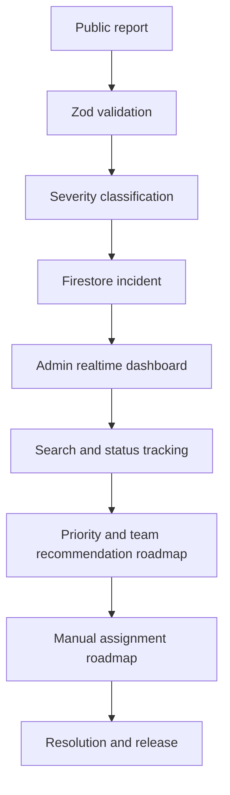

# DIASA Application Flow

Public users never read incident records. Administrators authenticate, pass the UID/role/active check, then access protected views. Incident status currently supports `Reported`, `Pending`, `In Progress`, and `Resolved`; `Assigned` is reserved for the assignment milestone and must be added with coordinated UI and rules changes.
